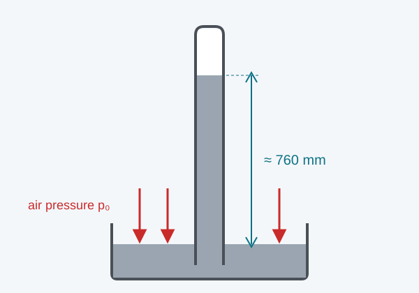

<!--
author:   Hannes Tegelbeckers
email:    hannes.tegelbeckers@ovgu.de
version:  0.1.0
language: en
narrator: US English Female
mode:     Presentation
comment:  Interactive demo session on air pressure, built only from content and the slide templates.

import:   https://raw.githubusercontent.com/LiaTemplates/mermaid_template/0.1.4/README.md
          https://raw.githubusercontent.com/LiaTemplates/Pyodide/0.3.5/README.md
-->

# Air Pressure – Otto von Guericke's Hemispheres

Demo session built from the LiaScript slide templates · 11 templates, 14 slides

## Thirty Horses Against Nothing

    --{{0}}--
Regensburg, the eighth of May 1654. In front of the emperor, Otto von Guericke, the mayor of Magdeburg, presents two copper half-spheres.

<!-- style="max-width:100%;width:60%;display:block;margin:0 auto;" -->


Guericke puts the two hemispheres together and pumps the air out with the air pump he has invented. Then two teams of fifteen horses are hitched to the hemispheres and driven apart.

    --{{1}}--
Here is the question that will guide us today.

      {{1}}
> [!IMPORTANT] Guiding question
> How can "nothing" – an empty space – hold the hemispheres together so strongly?

    --{{2}}--
What do you think happened?

      {{2}}
****************************************

**Predict:** What happened when the horses pulled?

<!-- data-hint-button="1" data-solution-button="2" -->
- [(X)] The horses could not separate the hemispheres
- [( )] The hemispheres flew apart at once
- [( )] The hemispheres were crushed flat
[[?]] Think about what presses on the hemispheres from the outside.
***
Right – thirty horses were not strong enough.
***

****************************************

    --{{3}}--
Then Guericke opened a small valve, and the hemispheres simply fell apart.

      {{3}}
> [!NOTE] What really happened
> Only when Guericke opened the valve and let air back in did the hemispheres come apart – by hand. Today you find out which force held them together.

## Today's Path

    --{{0}}--
Today we follow Guericke's experiment in five steps.


    --{{1}}--
Along this path you gain three kinds of outcomes.

      {{1}}
<div>

<!-- data-type="none" -->
| Know | Can do | Value |
|------|--------|-------|
| Define pressure as force per area | Calculate forces caused by air pressure | Appreciate experiments as evidence |
| Name typical air pressure values | Explain how a barometer works | Check results for plausibility |

</div>

    --{{2}}--
Can you read the path?

      {{2}}
****************************************

**Decide:** Which step comes directly before "Measuring pressure"?

<!-- data-hint-button="1" data-solution-button="2" -->
- [(X)] Hemisphere force
- [( )] Air has weight
- [( )] Apply and check
[[?]] Follow the arrows from left to right.
***
First we calculate the force on the hemispheres, then we see how air pressure itself is measured.
***

****************************************

## Living at the Bottom of an Ocean of Air

    --{{0}}--
We do not feel it, but we live at the bottom of an ocean of air that is many kilometres deep.

<div style="display:flex;gap:1.5rem;flex-wrap:wrap;align-items:center;">
<div style="flex:1 1 260px;">


</div>
<div style="flex:2 1 320px;">

Air has weight. The air column above every square metre of the Earth's surface weighs about **10 tonnes**. This weight presses on everything around us – from all sides. Guericke's hemispheres made this invisible pressure visible.

</div>
</div>

    --{{1}}--
Keep one idea in mind.

      {{1}}
> [!NOTE] Key message
> Air pressure is caused by the weight of the air above us: at sea level about 101 325 Pa.

    --{{2}}--
A quick check before we start.

      {{2}}
****************************************

**Type:** What is the SI unit of pressure?

<!-- data-hint-button="1" data-solution-button="2" -->
[[pascal]]
[[?]] It is named after the French scientist Blaise Pascal.
<script>
const given = `@input`.trim().toLowerCase()
// ADAPT: add further accepted spellings
const accepted = ["pascal"]
accepted.map(a => a.trim().toLowerCase()).includes(given)
</script>
***
Correct: 1 Pa = 1 N/m².
***

****************************************

## Pressure Is Force per Area

    --{{0}}--
Pressure tells us how strongly a force is spread over a surface.

> [!IMPORTANT] Definition
> Pressure is the force acting perpendicular on a surface, divided by the area of that surface.

    --{{1}}--
So the same pressure produces a larger force on a larger area.

      {{1}}
****************************************

$$
p = \frac{F}{A} \qquad \Leftrightarrow \qquad F = p \cdot A
$$

<!-- data-type="none" -->
| Symbol | Meaning | Unit |
|--------|---------|------|
| $p$ | pressure | Pa = N/m² |
| $F$ | force perpendicular to the surface | N |
| $A$ | area | m² |

****************************************

## Worked Example: Your Hand

    --{{0}}--
How strongly does the air press on your open hand?

**Problem:** An open hand has an area of about 0.01 m². How large is the force of the air on it (p₀ = 101 325 Pa)?

    --{{1}}--
First, we solve the formula for the force.

      {{1}}
1. $F = p_0 \cdot A$

    --{{2}}--
Then we insert the values.

      {{2}}
2. $F = 101\,325\ \text{Pa} \cdot 0.01\ \text{m}^2$

    --{{3}}--
That is about the weight of a hundred kilograms – and you do not feel it, because the air presses from both sides.

      {{3}}
3. $F \approx 1013\ \text{N}$ – the weight of about 100 kg

    --{{4}}--
Now it is your turn.

      {{4}}
****************************************

**Calculate:** A table top measures 1.2 m × 0.8 m. How large is the force of the air on it, in kN?

<!-- data-hint-button="1" data-solution-button="2" -->
[[97.27]]
[[?]] First calculate the area A of the table top.
[[?]] F = 101 325 Pa · 0.96 m², then divide by 1000.
<script>
const v = parseFloat(`@input`.replace(",", "."))
const ref = parseFloat("97.27")
// ADAPT: relative tolerance (0.02 = 2 %)
Math.abs(v - ref) <= 0.02 * Math.abs(ref)
</script>
***
A = 1.2 m · 0.8 m = 0.96 m² and F = 101 325 Pa · 0.96 m² ≈ 97 272 N ≈ 97.3 kN. The table does not break, because the air pushes from below with the same force.
***

****************************************

## How Strong Is the Vacuum?

    --{{0}}--
Before you try the model, make a prediction.

**Predict:** Guericke doubles the radius of his hemispheres. How does the force holding them together change?

<!-- data-hint-button="1" data-solution-button="2" -->
- [( )] It doubles
- [(X)] It becomes four times as large
- [( )] It stays the same
[[?]] The force acts on the circle at the joint: A = π r².

    --{{1}}--
Now change the radius and the quality of the vacuum and watch the force.

      {{1}}
****************************************

**Try it:** Move the sliders.

Radius r in cm: <script input="range" min="5" max="60" step="1" value="25" default="25" output="p1" aria-label="Radius r in cm">@input</script>

Air removed in %: <script input="range" min="0" max="100" step="5" value="100" default="100" output="p2" aria-label="Air removed in %">@input</script>

<script>
const model = (p1, p2) => 101325 * (p2 / 100) * Math.PI * (p1 / 100) ** 2 / 1000
const corners = [model(5, 0), model(5, 100),
                 model(60, 0), model(60, 100)]
const maxResult = Math.max(...corners.map(Math.abs)) || 1
const p1 = parseFloat(@input(`p1`))
const p2 = parseFloat(@input(`p2`))
const result = model(p1, p2)
const pct = Math.min(100, 100 * Math.abs(result) / maxResult).toFixed(1)
"LIASCRIPT: <!-- data-type=\"none\" -->\n" +
"| Radius r in cm | Air removed in % | Force F |\n|---|---|---|\n" +
"| " + p1 + " | " + p2 + " | **" + result.toFixed(1) + " kN** |\n\n" +
"<div style=\"background:#dee2e6;border-radius:4px;max-width:420px;\"><div style=\"background:#0b7285;height:12px;border-radius:4px;width:" + pct + "%;\"></div></div>"
</script>

****************************************

    --{{2}}--
Start with Guericke's original hemispheres.

      {{2}}
**Explore 1:** Set r = 25 cm and 100 %. This is the size of Guericke's hemispheres. How large is F, and how many tonnes could this force lift?

    --{{3}}--
Guericke's pump was not perfect.

      {{3}}
****************************************

**Explore 2:** Keep r = 25 cm and remove only half of the air. What happens to the force? Then double the radius.

> [!NOTE] Key message
> The force grows in proportion to the pressure difference and with the square of the radius.

****************************************

## How Do We Measure Air Pressure?

    --{{0}}--
In 1643 Evangelista Torricelli built the first barometer. It has three main parts.

<div style="position:relative;display:inline-block;width:600px;max-width:100%;">



<span style="position:absolute;left:50%;top:18%;transform:translate(-50%,-50%);background:#c92a2a;color:#fff;border-radius:50%;width:1.8em;height:1.8em;line-height:1.8em;text-align:center;font-weight:bold;">1</span>
<span style="position:absolute;left:50%;top:55%;transform:translate(-50%,-50%);background:#c92a2a;color:#fff;border-radius:50%;width:1.8em;height:1.8em;line-height:1.8em;text-align:center;font-weight:bold;">2</span>
<span style="position:absolute;left:32%;top:89%;transform:translate(-50%,-50%);background:#c92a2a;color:#fff;border-radius:50%;width:1.8em;height:1.8em;line-height:1.8em;text-align:center;font-weight:bold;">3</span>

</div>

    --{{1}}--
At the top of the closed tube there is a vacuum.

      {{1}}
**① Vacuum:** Empty space – nothing presses on the mercury from above.

    --{{2}}--
Below it stands a column of mercury.

      {{2}}
**② Mercury column:** Its height of about 760 mm shows the air pressure: the higher the column, the higher the pressure.

    --{{3}}--
And at the bottom, the air presses on the open dish.

      {{3}}
**③ Mercury dish:** Here the air presses on the open mercury surface and holds the column up.

## Label the Barometer

    --{{0}}--
Now drag the names to the right numbers.

<div style="position:relative;display:inline-block;width:600px;max-width:100%;">


<span style="position:absolute;left:50%;top:18%;transform:translate(-50%,-50%);background:#c92a2a;color:#fff;border-radius:50%;width:1.8em;height:1.8em;line-height:1.8em;text-align:center;font-weight:bold;">1</span>
<span style="position:absolute;left:50%;top:55%;transform:translate(-50%,-50%);background:#c92a2a;color:#fff;border-radius:50%;width:1.8em;height:1.8em;line-height:1.8em;text-align:center;font-weight:bold;">2</span>
<span style="position:absolute;left:32%;top:89%;transform:translate(-50%,-50%);background:#c92a2a;color:#fff;border-radius:50%;width:1.8em;height:1.8em;line-height:1.8em;text-align:center;font-weight:bold;">3</span>

</div>

**Label:** Drag each name to its number.

<!-- data-randomize data-show-partial-solution data-solution-button="2" -->
① [->[ Vacuum ]] ② [->[ Mercury column ]] ③ [->[ Mercury dish ]]

## Experiment: Pressure in Air and Water

    --{{0}}--
In this simulation you measure the pressure above and below a water surface yourself.

<iframe src="https://phet.colorado.edu/sims/html/under-pressure/latest/under-pressure_en.html" width="100%" height="480" style="border:0;" allowfullscreen title="PhET Under Pressure, University of Colorado Boulder, CC BY 4.0"></iframe>

*PhET Under Pressure, University of Colorado Boulder, CC BY 4.0* · [Open in a new tab](https://phet.colorado.edu/sims/html/under-pressure/latest/under-pressure_en.html)

    --{{1}}--
First, get to know the controls.

      {{1}}
**Task 1 · Explore:** Open the first screen, switch the atmosphere on and move the pressure gauge from the air down to the bottom of the pool.

    --{{2}}--
Now measure one value exactly.

      {{2}}
****************************************

**Task 2 · Measure:** With the atmosphere on, place the gauge exactly at the water surface. Which pressure does it show in kPa?

<!-- data-hint-button="1" data-solution-button="2" -->
[[101.3]]
[[?]] Place the centre of the gauge exactly on the water surface.
<script>
const v = parseFloat(`@input`.replace(",", "."))
const ref = parseFloat("101.3")
// ADAPT: relative tolerance (0.05 = 5 %, reading values off a simulation is imprecise)
Math.abs(v - ref) <= 0.05 * Math.abs(ref)
</script>
***
About 101.3 kPa – the weight of the air column above the pool.
***

****************************************

    --{{3}}--
What do you conclude?

      {{3}}
****************************************

**Conclude:** Switch the atmosphere off and on again. How does this change the pressure at the bottom of the pool, and why?

[[___ ___ ___]]

****************************************

## Air Pressure in Numbers

    --{{0}}--
Complete the text. Choose, type or drag the missing words.

**Complete:**

<!-- data-hint-button="1" data-solution-button="2" data-show-partial-solution -->
At sea level the air pressure is about [[ (1013 hPa) | 101 hPa | 10 hPa ]] . One bar equals [[100]]kPa, and with increasing altitude the air pressure [->[ (decreases) | increases ]].
[[?]] Weather maps show values around 1000 hPa, and 1 hPa = 100 Pa.

    --{{1}}--
Now decide: true or false?

      {{1}}
****************************************

**Decide:** True or false?

<!-- data-hint-button="1" data-solution-button="2" data-show-partial-solution -->
[(true) (false)]
[  (X)    ( )  ] The air presses on every square metre with a force of about 100 kN.
[  ( )    (X)  ] Air pressure acts only downwards.
[  (X)    ( )  ] Guericke's horses were working against the air outside, not against the vacuum inside.
[  ( )    (X)  ] A vacuum inside the hemispheres pulls them together.
[[?]] A vacuum cannot pull – only the air outside can push.
***
Air pressure acts in all directions. The hemispheres are pushed together from outside, because nothing pushes back from inside.
***

****************************************

## Spot the Mistake

    --{{0}}--
A student calculated the force on Guericke's hemispheres. One of the four steps is wrong.

**Task:** Calculate the force that holds the hemispheres together (diameter 50 cm, perfect vacuum inside, p₀ = 101 325 Pa), in kN.

<!-- data-type="none" -->
| Step | Student solution |
|------|------------------|
| 1 | $F = p_0 \cdot A$ |
| 2 | $A = \pi r^2$ |
| 3 | $A = \pi \cdot (0.50\ \text{m})^2 = 0.785\ \text{m}^2$ |
| 4 | $F = 101\,325\ \text{Pa} \cdot 0.785\ \text{m}^2 \approx 79.6\ \text{kN}$ |

    --{{1}}--
Which step is wrong?

      {{1}}
****************************************

**Locate:** Which step contains the mistake?

<!-- data-hint-button="1" data-solution-button="2" -->
- [( )] Step 1
- [( )] Step 2
- [(X)] Step 3
- [( )] Step 4
[[?]] Compare the length used in step 3 with the data given in the task.
***
Step 3 uses the diameter (0.50 m) instead of the radius (0.25 m), so the area – and the force – come out four times too large.
***

****************************************

    --{{2}}--
Now give the correct result.

      {{2}}
****************************************

**Correct:** What is the correct force in kN?

<!-- data-hint-button="1" data-solution-button="2" -->
[[19.9]]
[[?]] Repeat step 3 with r = 0.25 m.
<script>
const v = parseFloat(`@input`.replace(",", "."))
const ref = parseFloat("19.9")
// ADAPT: relative tolerance (0.02 = 2 %)
Math.abs(v - ref) <= 0.02 * Math.abs(ref)
</script>
***
r = 0.25 m, A = π · (0.25 m)² ≈ 0.196 m², F = 101 325 Pa · 0.196 m² ≈ 19.9 kN – about the weight of two tonnes.
***

****************************************

## Air Pressure and Altitude

    --{{0}}--
The higher we go, the less air lies above us. This program calculates the air pressure at different altitudes.

The program uses the barometric formula p = p₀ · e^(−h/H) with a scale height H of about 8.4 km.

**Try it:** Click ▶ below the code.

```python
import math

p0 = 101325     # pressure at sea level in Pa
H = 8400        # scale height of the atmosphere in m

for h in range(0, 11000, 1000):
    p = p0 * math.exp(-h / H)
    print(f"{h:6d} m: {p / 1000:6.1f} kPa")
```
@Pyodide.eval

    --{{1}}--
Run the program and read the table.

      {{1}}
****************************************

**Explore:** At which altitude in the table (in m) does the pressure first drop below half of the sea-level value?

<!-- data-hint-button="1" data-solution-button="2" -->
[[6000]]
[[?]] Half of 101.3 kPa is about 50.7 kPa.
<script>
const v = parseFloat(`@input`.replace(",", "."))
const ref = parseFloat("6000")
// ADAPT: relative tolerance (0 = exact)
Math.abs(v - ref) <= 0 * Math.abs(ref)
</script>
***
At 6000 m the pressure is only 49.6 kPa – mountaineers feel this as "thin air".
***

****************************************

## Find the Error

    --{{0}}--
This program should print the same table, but it crashes.

**Repair:** Run the program, read the error message and repair the faulty line.

```python
import math

p0 = 101325
H = 8400

for h in range(0, 11000, 1000):
    p = p0 * math.exp(-h / scale)
    print(f"{h:6d} m: {p / 1000:6.1f} kPa")
```
@Pyodide.eval

    --{{1}}--
Stuck? Open the hints one after another.

      {{1}}
****************************************

<details>

<summary>💡 Hint 1</summary>

Read the last line of the error message: which name is unknown?

</details>
<details>

<summary>💡 Hint 2</summary>

Line 7 uses a name that is never defined. Which variable holds the scale height?

</details>
<details>

<summary>✅ Solution</summary>

`p = p0 * math.exp(-h / H)`

</details>

****************************************

## Exit Ticket

    --{{0}}--
Before you leave, answer three short questions – one for each goal of today.

**🎟️ 1 · Explain air pressure** – Why could the horses not pull the hemispheres apart?

<!-- data-hint-button="1" data-solution-button="2" -->
- [(X)] The air outside pressed them together
- [( )] The vacuum inside pulled them together
- [( )] The rims were glued together
[[?]] A vacuum cannot pull.

    --{{1}}--
Second question – several answers can be right.

      {{1}}
****************************************

**🎟️ 2 · Use pressure units** – Which values describe normal air pressure at sea level?

<!-- data-hint-button="1" data-solution-button="2" -->
- [[X]] 1013 hPa
- [[ ]] 10 bar
- [[X]] 101.3 kPa
[[?]] 1 bar = 1000 hPa = 100 kPa.

****************************************

    --{{2}}--
And finally, calculate.

      {{2}}
****************************************

**🎟️ 3 · Calculate forces** – Air pressure (101 325 Pa) acts on a window of 0.5 m². How large is the force in kN?

<!-- data-hint-button="1" data-solution-button="2" -->
[[50.7]]
[[?]] F = p · A, then divide by 1000.
<script>
const v = parseFloat(`@input`.replace(",", "."))
const ref = parseFloat("50.7")
// ADAPT: relative tolerance (0.02 = 2 %)
Math.abs(v - ref) <= 0.02 * Math.abs(ref)
</script>

****************************************
