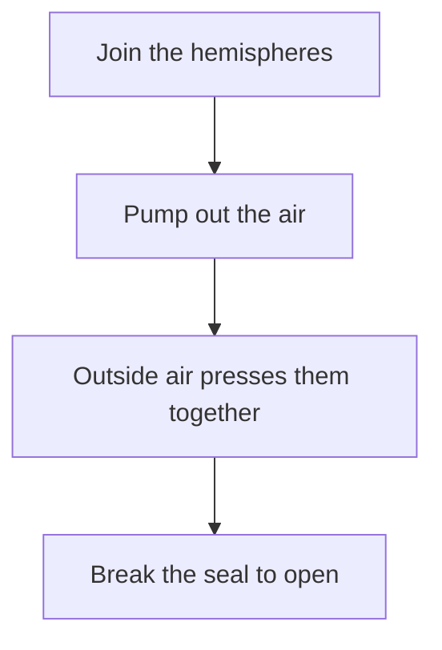

<!--
author:   gx10 demo
email:    demo@gx10.example
version:  0.2.0
language: en
narrator: US English Female
mode:     Presentation
comment:  Air pressure and Otto von Guericke's Magdeburg hemispheres.

import:   https://raw.githubusercontent.com/LiaTemplates/mermaid_template/0.1.4/README.md
-->

# Air Pressure – Otto von Guericke's Hemispheres

## Air Pressure – Otto von Guericke's Hemispheres

    --{{0}}--
Welcome to this session on air pressure. In 1654 a German inventor pulled two hemispheres apart with eight horses on each side, and nobody could believe it. Today we explain that experiment with physics.

This session is for first-year university students.

    --{{1}}--
First, who this session is for.

      {{1}}
**Who:** First-year university students in physics and engineering

    --{{2}}--
Next, what you will learn.

      {{2}}
**What:** What air pressure is and how to compute the force it exerts

    --{{3}}--
Then why it matters to you.

      {{3}}
**Why:** To understand everyday forces from vacuum packaging to braking systems

    --{{4}}--
And finally, how the session will run.

      {{4}}
**How:** Interactive lessons with quizzes, a live simulation and a video

    --{{5}}--
Let me end with a quick question for you.

      {{5}}
****************************************

**Associate:** one word you associate with air pressure

[[___]]

****************************************

## Your Roadmap Through Air Pressure

    --{{0}}--
Here is the whole session on one screen: five building blocks that lead from a 400-year-old experiment to a formula you can use yourself.

> [!NOTE] Key message
> Each block builds on the one before it, so the order matters for your understanding.

    --{{1}}--
Let us be concrete about what you will take away.

      {{1}}
<!-- data-type="none" -->
| Know | Can do | Value |
|---|---|---|
| The definition and unit of pressure | Compute the force on a surface | The power of simple physics |
| The idea of a pressure difference | Estimate forces from air pressure | Reliable order-of-magnitude checks |
| How the hemispheres stay together | Explain the experiment quantitatively | Careful unit conversion |

    --{{2}}--
Quick check: can you already see the order?

      {{2}}
****************************************

**Decide:** Which step comes directly before Calculating the force?

<!-- data-hint-button="1" data-solution-button="2" -->
- [(X)] Defining pressure
- [( )] Measuring pressure
- [( )] Applications
[[?]] Look at the flowchart: which box points directly into Calculating the force?
***
Right – you define pressure before you can use it to calculate a force.
***

****************************************

## The Magdeburg Hemispheres Experiment

    --{{0}}--
In 1654 Otto von Guericke joined two hollow hemispheres, pumped the air out, and let horses pull. The sphere would not open. Let us follow the experiment step by step.

    --{{1}}--
Here is the whole experiment as a flowchart.

      {{1}}

    --{{2}}--
Let us look at the first step.

      {{2}}
**Step 1:** Two hollow metal hemispheres are placed together with a seal between them, forming a closed sphere.

    --{{3}}--
Now the second step.

      {{3}}
**Step 2:** A pump removes most of the air from inside the sphere, creating a low-pressure region.

    --{{4}}--
And the third step.

      {{4}}
**Step 3:** The full atmospheric pressure outside now pushes on the sphere, pressing the two halves together with a huge force.

    --{{5}}--
Finally the fourth step.

      {{5}}
**Step 4:** Only when the seal is broken and air rushes back in do the hemispheres come apart.

> [!NOTE] Key message
> The holding force comes from the pressure difference between outside and inside, not from any lock.

## Put the Steps in Order

    --{{0}}--
Let us check whether you can rebuild the experiment yourself.

**Order:** Drag the four steps into the correct order.

<!-- data-randomize data-show-partial-solution -->
Step 1: [->[ Join the hemispheres ]] → Step 2: [->[ Pump out the air ]] → Step 3: [->[ Outside air presses them together ]] → Step 4: [->[ Break the seal to open ]]

## Pressure, the Force per Area

    --{{0}}--
We now need one definition you will use all week. Pressure tells us how much force acts on a given surface.

> [!IMPORTANT] Definition
> Pressure is the force acting perpendicular to a surface, divided by the area of that surface.

    --{{1}}--
The law is one short equation.

      {{1}}
$$
p = \frac{F}{A}
$$

    --{{2}}--
Here is what every symbol means.

      {{2}}
****************************************

<!-- data-type="none" -->
| Symbol | Unit | Meaning |
|---|---|---|
| p | Pa | pressure |
| F | N | force |
| A | m² | area |
| 1 Pa | N/m² | one pascal |
| 1 bar | 100000 Pa | atmospheric scale |

****************************************

## Worked Example

    --{{0}}--
Let us apply the definition to a concrete case.

**Given:** F = 10000 N, A = 100 cm²

    --{{1}}--
First we convert the area into square meters.

      {{1}}
**Step 1 – Substitute:** 100 cm² = 0.01 m², so p = F / A = 10000 / 0.01

    --{{2}}--
Then we divide.

      {{2}}
**Step 2 – Divide:** p = 1000000 Pa

    --{{3}}--
Finally we read the result in familiar units.

      {{3}}
**Step 3 – Convert:** p = 1000000 Pa = 10 bar

    --{{4}}--
Now check it yourself.

      {{4}}
****************************************

**Type:** What is the pressure in bar, rounded to the nearest whole number?

<!-- data-hint-button="1" data-solution-button="2" -->
[[10]]
[[?]] Convert the area to m² before dividing: 100 cm² is 0.01 m².
[[?]] Divide 10000 N by 0.01 m² to get pascals, then divide by 100000.

***
p = 10000 / 0.01 = 1000000 Pa, and 1000000 Pa is 10 bar.
***

****************************************

## Atmospheric Pressure vs. Vacuum

    --{{0}}--
We meet two similar-sounding states that behave very differently. One is the air around us, the other is the absence of air.

<!-- data-type="none" -->
| Criterion | Atmospheric pressure | Vacuum |
|---|---|---|
| Source | Air molecules hitting surfaces | Almost no gas molecules |
| Typical value | About 100000 Pa | Near 0 Pa |
| Force on a surface | Large, measurable | Almost none |
| Typical use | Holding the hemispheres together | Inside the pumped sphere |

    --{{1}}--
Let us make this concrete with two everyday cases.

      {{1}}
****************************************

> [!NOTE] Key message
> Atmospheric pressure pushes on every surface, while a vacuum removes that push from one side.

**Atmospheric pressure:** The air above you presses down with about 100000 Pa, which is why the hemispheres stay closed.
**Vacuum:** The inside of the pumped sphere has almost no air, so it pushes back with almost no force.

****************************************

    --{{2}}--
One mistake happens in almost every exam.

      {{2}}
> [!WARNING] Common misconception
> Air is not weightless and forceless. The column of air above you creates about 100000 Pa on every surface.

    --{{3}}--
Now you classify four statements yourself.

      {{3}}
****************************************

**Try it:** Classify each statement as Atmospheric pressure (A) or Vacuum (B).

<!-- data-hint-button="1" data-solution-button="2" data-show-partial-solution -->
[(A) (B)]
[  (X)    ( )  ] It comes from air molecules hitting a surface
[  ( )    (X)  ] It is almost zero inside the pumped sphere
[  ( )    (X)  ] It produces almost no force on a surface
[  (X)    ( )  ] It holds the two hemispheres together
[[?]] Ask yourself for each row: is there air present or not?
***
Atmospheric pressure comes from real air and pushes hard. A vacuum has almost no air and almost no force.
***

****************************************

## Check Your Pressure Knowledge

    --{{0}}--
Let us see what the hemispheres story has already taught us.

    --{{1}}--
First, a single choice on the formula.

      {{1}}
****************************************

**Choose:** If the cross-section area of the hemispheres doubles, what happens to the holding force?

<!-- data-hint-button="1" data-solution-button="2" -->
- [(X)] The force doubles
- [( )] The force quadruples
- [( )] The force stays the same
[[?]] Use F = p × A and keep the pressure difference fixed.
***
Yes – with a fixed pressure difference the force grows in direct proportion to the area.
***

****************************************

    --{{2}}--
Now pick all the factors that determine the holding force.

      {{2}}
****************************************

**Select all that apply:** Which factors determine the holding force on the hemispheres?

<!-- data-hint-button="1" data-solution-button="2" -->
- [(X)] The pressure difference between outside and inside
- [(X)] The cross-section area of the sphere
- [( )] The mass of the hemispheres
- [( )] The speed of the pump
[[?]] The force is the pressure difference times the area, nothing else.
***
Exactly – only the pressure difference and the area matter for the force.
***

****************************************

    --{{3}}--
Last one – type the SI unit of pressure.

      {{3}}
****************************************

**Type:** What is the SI unit of pressure?

[[pascal]]
[[?]] It is named after a 17th-century French scientist.

***
Correct – the pascal, one newton per square meter.
***

****************************************

## The Force on the Hemispheres

    --{{0}}--
Our model is the force on a circular cross-section. The pressure difference sets how hard the air pushes, and the radius sets how large the area is.

The force is F = Δp × A, and the cross-section of a sphere with radius r has area A = π r².

    --{{1}}--
Before you touch the sliders, make a prediction.

      {{1}}
****************************************

**Predict:** If you double the radius, what happens to the force?

<!-- data-hint-button="1" data-solution-button="2" -->
- [(X)] It grows by a factor of four
- [( )] It doubles
- [( )] It stays the same
[[?]] The area depends on the radius squared.
***
Right – the area, and with it the force, grows with r².
***

****************************************

    --{{2}}--
Now you control the model yourself. Move the radius and the pressure difference and watch the force.

      {{2}}
Pressure difference Δp (kPa): 

Radius r (m): 

    --{{3}}--
Now test your prediction by doubling the radius.

      {{3}}
**Try it:** What happens to the force when you double the radius?

💡 Hint 1

Compare the force before and after you change the radius.

💡 Hint 2

The area is π r², so it depends on the radius squared.

✅ Solution

Doubling the radius multiplies the area, and the force, by a factor of four.

    --{{4}}--
And what radius would you need for a smaller force?

      {{4}}
**Try it:** With Δp = 100 kPa, which radius gives a force of about 10 kN?

💡 Hint 1

Set the pressure difference to 100 kPa and move the radius slowly.

💡 Hint 2

Solve r = sqrt(F / (π Δp)) with F = 10000 N and Δp = 100000 Pa.

✅ Solution

r = sqrt(10000 / (π × 100000)) ≈ 0.18 m, so about 0.2 m gives a force near 10 kN.

    --{{5}}--
Let us collect what the sliders taught us.

      {{5}}
> [!NOTE] Key message
> The pressure difference sets how hard the air pushes, and the radius sets how large the area is. Force is the product of both.

## A Historic Demonstration

    --{{0}}--
We are going to watch a short clip of a modern reenactment of the Magdeburg hemispheres experiment.

> [!TIP] Watch for
> - How many horses struggle to pull the two halves apart.
> - The moment the sphere finally splits open.

!?[Magdeburg hemispheres demonstration with horses](https://www.youtube.com/watch?v=0BhZ1VZ1Z1Y "Public domain demonstration footage")

📝 Text summary

Two teams of horses pull in opposite directions, but the sphere does not open. Only when air is allowed back into the sphere does the pressure difference disappear and the halves come apart.

## Check Your Understanding

    --{{0}}--
Let us check what you saw in the video.

**Decide:** Why do the hemispheres stay together while the air is pumped out?

<!-- data-hint-button="1" data-solution-button="2" -->
- [(X)] The outside air pressure is greater than the inside pressure
- [( )] The horses pull them together
- [( )] The metal halves are magnetically attracted
[[?]] Think about what pushes on the outside when the inside is nearly empty.
***
Right – the pressure difference, not the horses, holds the halves together.
***

    --{{1}}--
Now name the scientist in one phrase.

      {{1}}
**Type:** Who demonstrated the Magdeburg hemispheres in 1654?

[[Otto von Guericke]]
[[?]] He was a German inventor and mayor of Magdeburg.

## What You Take Home Today

    --{{0}}--
Let us collect what we have built today before we finish.

    --{{1}}--
First, the experiment that seemed impossible was explained by air.

      {{1}}
- The Magdeburg hemispheres stay closed because of the pressure difference, not a lock.

    --{{2}}--
Second, pressure is simply force spread over an area.

      {{2}}
- Pressure is defined as p = F / A and measured in pascals.

    --{{3}}--
Third, the force follows directly from the pressure difference.

      {{3}}
- The holding force is F = Δp × A, with A = π r² for a sphere.

    --{{4}}--
Fourth, you can now estimate these forces yourself.

      {{4}}
- A 100 kPa difference on a 0.25 m sphere produces roughly 20 kN of force.

    --{{5}}--
Here is the one thing to remember, and here is where we go next.

      {{5}}
****************************************

> [!NOTE] Remember
> Air pressure is real and strong. A pressure difference of 100000 Pa on even a small area produces a force of several thousand newtons.

**Outlook:** Next time we measure air pressure with a barometer and connect it to weather.

****************************************

## Last Check

    --{{0}}--
One last check to make sure the main idea is clear.

      {{1}}
**Decide:** Which sentence captures the main idea of today's session?

<!-- data-hint-button="1" data-solution-button="2" -->
- [(X)] The holding force equals the pressure difference times the cross-section area
- [( )] The hemispheres stay together because of a mechanical lock
- [( )] Air pressure only matters in very tall buildings
[[?]] Think about the formula F = Δp × A that we used all session.
***
Right – the pressure difference times the area is the core of today.
***
