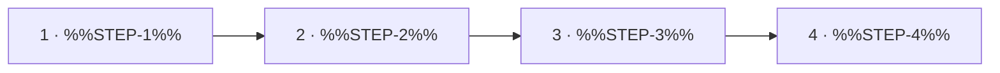

<!--
author:   %%AUTHOR%%
email:    %%EMAIL%%
version:  0.2.0
language: en
narrator: US English Female
mode:     Presentation
comment:  Process or structure explained with a Mermaid diagram, narrated steps and a drag and drop ordering task.

import:   https://raw.githubusercontent.com/LiaTemplates/mermaid_template/0.1.4/README.md
-->

# Template `Concept_Explanation_Template_3`

- **Purpose:** Explain a process (workflow, cycle, algorithm, causal chain) with a diagram and one narrated step at a time.
- **Pairs with:** `Content_Introduction_Template_1`, `Interactive_Exercise_Template_2`, `Simulation_Template_2`
- **Variants:** Change LR to TD in the chart for a vertical layout. For a cycle add the chart line `S4 ==> S1`. Add a distractor card to the ordering task by writing `( %%STEP-4%% ) | Distractor` inside the last gap.

<!-- data-type="none" -->
| Placeholder | Meaning | Limit | Example |
|---|---|---|---|
| `%%SLIDE-TITLE%%` | Name of the process | max 5 words | The Design Cycle |
| `%%NARRATION-0%%` | Spoken overview | 1–2 sentences | The design cycle has four steps that repeat until the product works. |
| `%%STEP-1%%` … `%%STEP-4%%` | Step name, no quotes | max 3 words | Analyse ; Design ; Build ; Test |
| `%%NARRATION-1%%` … `%%NARRATION-4%%` | Spoken explanation per step | 1–2 sentences | Everything starts with understanding the problem. ; Then we develop a solution on paper. ; Next, we build a prototype. ; Finally, we test it against the requirements. |
| `%%STEP-TEXT-1%%` … `%%STEP-TEXT-4%%` | Short explanation per step | max 15 words | Collect requirements and constraints. ; Sketch and compare solution ideas. ; Build a first working prototype. ; Check the prototype against the requirements. |
| `%%ORDER-TITLE%%` | Title of the ordering slide | max 5 words | Put It in Order |
| `%%NARRATION-ORDER-0%%` | Spoken intro to the task | 1 sentence | Drag the steps into the right order. |

<!-- TEMPLATE:BEGIN -->

## %%SLIDE-TITLE%%

    --{{0}}--
%%NARRATION-0%%

    --{{1}}--
%%NARRATION-1%%

      {{1}}
1. **%%STEP-1%%:** %%STEP-TEXT-1%%

    --{{2}}--
%%NARRATION-2%%

      {{2}}
2. **%%STEP-2%%:** %%STEP-TEXT-2%%

    --{{3}}--
%%NARRATION-3%%

      {{3}}
3. **%%STEP-3%%:** %%STEP-TEXT-3%%

    --{{4}}--
%%NARRATION-4%%

      {{4}}
4. **%%STEP-4%%:** %%STEP-TEXT-4%%

## %%ORDER-TITLE%%

    --{{0}}--
%%NARRATION-ORDER-0%%

**Order:** Drag each card into the right gap.

<!-- data-randomize data-show-partial-solution data-solution-button="2" -->
Step 1: [->[ %%STEP-1%% ]] → Step 2: [->[ %%STEP-2%% ]] → Step 3: [->[ %%STEP-3%% ]] → Step 4: [->[ %%STEP-4%% ]]

<!-- TEMPLATE:END -->
