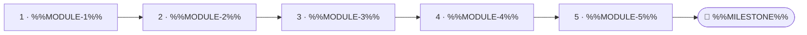

<!--
author:   %%AUTHOR%%
email:    %%EMAIL%%
version:  0.2.0
language: en
narrator: US English Female
mode:     Presentation
comment:  Course overview as a visual roadmap (Mermaid) with objectives grouped into know, can do and value.

import:   https://raw.githubusercontent.com/LiaTemplates/mermaid_template/0.1.4/README.md
-->

# Template `Overview_Course_Template_2`

- **Purpose:** Show the learning path as a roadmap and group the objectives into knowledge, skills and attitudes.
- **Pairs with:** `Introduction_Template_2`, `Introduction_Template_3`, `Content_Introduction_Template_2`
- **Variants:** Add a node line M6 to the chart, or change LR to TD for a vertical path. Delete step 2 to skip the quiz.

<!-- data-type="none" -->
| Placeholder | Meaning | Limit | Example |
|---|---|---|---|
| `%%SLIDE-TITLE%%` | Title of the roadmap slide | max 5 words | Your Learning Path |
| `%%NARRATION-0%%` | Spoken intro to the roadmap | 1–2 sentences | Here is the path from the first idea to the final project. |
| `%%MODULE-1%%` … `%%MODULE-5%%` | Module name in the chart | max 3 words, no quotes | Basics ; Loads ; Analysis ; Design ; Project |
| `%%MILESTONE%%` | Final milestone or exam | max 3 words | Final exam |
| `%%NARRATION-1%%` | Spoken intro to the objectives | 1 sentence | Along this path you gain three kinds of outcomes. |
| `%%KNOW-1%%`, `%%KNOW-2%%` | Knowledge objectives | max 8 words | Name the main load types ; Describe common failure modes |
| `%%CAN-1%%`, `%%CAN-2%%` | Skill objectives | max 8 words | Size a simple beam ; Check a design with software |
| `%%VALUE-1%%`, `%%VALUE-2%%` | Attitude objectives | max 8 words | Value safety margins ; Appreciate clear documentation |
| `%%NARRATION-2%%` | Spoken intro to the quiz | 1 sentence | Check that you can read the roadmap. |
| `%%ORDER-QUESTION%%` | Question about the order | 1 sentence | Which module comes directly before Design? |
| `%%ORDER-CORRECT%%` | Correct module | one module name | Analysis |
| `%%ORDER-WRONG-1%%`, `%%ORDER-WRONG-2%%` | Other module names | one module name | Basics ; Project |
| `%%ORDER-HINT%%` | Hint | 1 sentence | Follow the arrows from left to right. |
| `%%ORDER-FEEDBACK%%` | Feedback after answering | 1 sentence | Analysis provides the loads that Design needs. |

<!-- TEMPLATE:BEGIN -->

## %%SLIDE-TITLE%%

    --{{0}}--
%%NARRATION-0%%

    --{{1}}--
%%NARRATION-1%%

      {{1}}

<!-- data-type="none" -->
| Know | Can do | Value |
|------|--------|-------|
| %%KNOW-1%% | %%CAN-1%% | %%VALUE-1%% |
| %%KNOW-2%% | %%CAN-2%% | %%VALUE-2%% |

    --{{2}}--
%%NARRATION-2%%

      {{2}}
****************************************

**Decide:** %%ORDER-QUESTION%%

<!-- data-hint-button="1" data-solution-button="2" -->
- [(X)] %%ORDER-CORRECT%%
- [( )] %%ORDER-WRONG-1%%
- [( )] %%ORDER-WRONG-2%%
[[?]] %%ORDER-HINT%%
***
%%ORDER-FEEDBACK%%
***

****************************************

<!-- TEMPLATE:END -->
