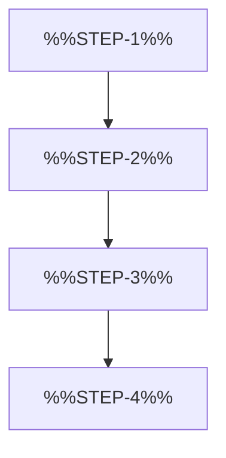

<!--
author:   %%AUTHOR%%
email:    %%EMAIL%%
version:  0.2.0
language: en
narrator: US English Female
mode:     Presentation
comment:  Explains a four-step process with a Mermaid flowchart and lets learners reorder the steps by drag and drop.

import:   https://raw.githubusercontent.com/LiaTemplates/mermaid_template/0.1.4/README.md
-->

# Template `Concept_Explanation_Template_3`

- **Purpose:** Explain a process with a flowchart, then check that learners can put the steps in the right order.
- **Pairs with:** `Concept_Explanation_Template_1`, `Concept_Explanation_Template_2`, `Interactive_Exercise_Template_2`
- **Variants:** Replace the four explanations with one image per step. Add a fifth step if the process is longer.

<!-- data-type="none" -->
| Placeholder | Meaning | Limit | Example |
|---|---|---|---|
| `%%SLIDE-TITLE%%` | Title of the process slide | max 6 words | How Rain Becomes Groundwater |
| `%%NARRATION-0%%` | Spoken intro to the process | 2–3 sentences | Today we follow one drop of rain from the sky to the water table. |
| `%%NARRATION-1%%` | Spoken intro to the flowchart | 1 sentence | Here is the whole process as a flowchart. |
| `%%STEP-1%%` … `%%STEP-4%%` | Step name in the flowchart | max 3 words | Rain hits the surface ; Water soaks into the soil ; Water drains downward ; Water reaches the aquifer |
| `%%NARRATION-2%%` | Spoken intro to step 1 | 1 sentence | Let us look at the first step. |
| `%%EXPL-1%%` | Explanation of step 1 | 1–2 sentences | Raindrops hit the ground and spread out. Some run off, some stay. |
| `%%NARRATION-3%%` | Spoken intro to step 2 | 1 sentence | Now the second step. |
| `%%EXPL-2%%` | Explanation of step 2 | 1–2 sentences | The water sinks into the soil and fills the tiny gaps between grains. |
| `%%NARRATION-4%%` | Spoken intro to step 3 | 1 sentence | And the third step. |
| `%%EXPL-3%%` | Explanation of step 3 | 1–2 sentences | Gravity pulls the water deeper, layer by layer. |
| `%%NARRATION-5%%` | Spoken intro to step 4 | 1 sentence | Finally the fourth step. |
| `%%EXPL-4%%` | Explanation of step 4 | 1–2 sentences | The water reaches the aquifer and becomes groundwater. |
| `%%KEY-MESSAGE%%` | One-sentence takeaway | 1 sentence | Infiltration and drainage are the two engines of this process. |
| `%%EX-TITLE%%` | Title of the practice slide | max 6 words | Put the Steps in Order |
| `%%NARRATION-EX-0%%` | Spoken intro to the task | 1–2 sentences | Let us check whether you can rebuild the process yourself. |

<!-- TEMPLATE:BEGIN -->

## %%SLIDE-TITLE%%

    --{{0}}--
%%NARRATION-0%%

    --{{1}}--
%%NARRATION-1%%

      {{1}}

    --{{2}}--
%%NARRATION-2%%

      {{2}}
**Step 1:** %%EXPL-1%%

    --{{3}}--
%%NARRATION-3%%

      {{3}}
**Step 2:** %%EXPL-2%%

    --{{4}}--
%%NARRATION-4%%

      {{4}}
**Step 3:** %%EXPL-3%%

    --{{5}}--
%%NARRATION-5%%

      {{5}}
**Step 4:** %%EXPL-4%%

> [!NOTE] Key message
> %%KEY-MESSAGE%%

## %%EX-TITLE%%

    --{{0}}--
%%NARRATION-EX-0%%

**Order:** Drag the four steps into the correct order.

<!-- data-randomize data-show-partial-solution -->
Step 1: [->[ %%STEP-1%% ]] → Step 2: [->[ %%STEP-2%% ]] → Step 3: [->[ %%STEP-3%% ]] → Step 4: [->[ %%STEP-4%% ]]

<!-- TEMPLATE:END -->
