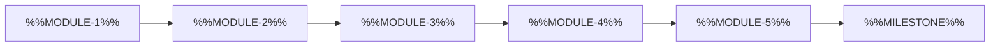

<!--
author:   %%AUTHOR%%
email:    %%EMAIL%%
version:  0.2.0
language: en
narrator: US English Female
mode:     Presentation
comment:  Course overview slide that maps the module roadmap and the learning outcomes, then checks the order.

import:   https://raw.githubusercontent.com/LiaTemplates/mermaid_template/0.1.4/README.md
-->

# Template `Overview_Course_Template_2`

- **Purpose:** Show the whole course at a glance with a visual roadmap and a compact outcome table before the first content block.
- **Pairs with:** `Introduction_Template_1`, `Overview_Course_Template_1`, `Overview_Course_Template_3`
- **Variants:** Replace the Mermaid flowchart with a module table (No, Module, Format, Duration). Swap the single-choice order quiz for a drag-and-drop ordering task in one shared pool.

<!-- data-type="none" -->
| Placeholder | Meaning | Limit | Example |
|---|---|---|---|
| `%%SLIDE-TITLE%%` | Title of the overview slide | max 6 words | Your Roadmap Through Data Science |
| `%%NARRATION-0%%` | Spoken welcome to the roadmap | 2–3 sentences | Here is the whole course on one screen: five modules that build on each other. |
| `%%MODULE-1%%` … `%%MODULE-5%%` | Module names in course order | max 3 words each | Python Basics ; Data Wrangling ; Data Visualization ; Statistics ; Capstone Project |
| `%%MILESTONE%%` | Final milestone of the roadmap | max 5 words | Present your capstone project |
| `%%KEY-MESSAGE%%` | Why the order matters | 1–2 sentences | Each module builds on the one before it, so the order matters for your learning. |
| `%%NARRATION-1%%` | Spoken intro to the outcomes | 1–2 sentences | Let us be concrete about what you will take away. |
| `%%KNOW-1%%` … `%%KNOW-3%%` | What learners will know | max 8 words each | The syntax of core Python ; The steps of a data pipeline ; The idea of statistical uncertainty |
| `%%CAN-DO-1%%` … `%%CAN-DO-3%%` | What learners can do | max 8 words each | Clean a messy dataset ; Draw a convincing chart ; Explain a simple model |
| `%%VALUE-1%%` … `%%VALUE-3%%` | What learners will value | max 8 words each | Reproducible analysis ; Clear communication of results ; Honest reporting of limits |
| `%%NARRATION-2%%` | Spoken intro to the order quiz | 1 sentence | Quick check: can you already see the order? |
| `%%ORDER-QUESTION%%` | Order question | 1 sentence | Which module comes before Data Visualization? |
| `%%ORDER-CORRECT%%` | Correct module (one of %%MODULE-1%% … %%MODULE-5%%) | max 3 words | Data Wrangling |
| `%%ORDER-WRONG-1%%` | Plausible wrong module | max 3 words | Statistics |
| `%%ORDER-WRONG-2%%` | Plausible wrong module | max 3 words | Capstone Project |
| `%%ORDER-HINT%%` | Hint | 1 sentence | Look at the flowchart: which box points directly into Data Visualization? |
| `%%ORDER-FEEDBACK%%` | Short feedback after answering | 1 sentence | Right – you wrangle the data before you can visualize it. |

<!-- TEMPLATE:BEGIN -->

## %%SLIDE-TITLE%%

    --{{0}}--
%%NARRATION-0%%

> [!NOTE] Key message
> %%KEY-MESSAGE%%

    --{{1}}--
%%NARRATION-1%%

      {{1}}
<!-- data-type="none" -->
| Know | Can do | Value |
|---|---|---|
| %%KNOW-1%% | %%CAN-DO-1%% | %%VALUE-1%% |
| %%KNOW-2%% | %%CAN-DO-2%% | %%VALUE-2%% |
| %%KNOW-3%% | %%CAN-DO-3%% | %%VALUE-3%% |

    --{{2}}--
%%NARRATION-2%%

      {{2}}
****************************************

**Decide:** %%ORDER-QUESTION%%

<!-- data-hint-button="1" data-solution-button="2" -->
- [(X)] %%ORDER-CORRECT%%
- [( )] %%ORDER-WRONG-1%%
- [( )] %%ORDER-WRONG-2%%
[[?]] %%ORDER-HINT%%
***
%%ORDER-FEEDBACK%%
***

****************************************

<!-- TEMPLATE:END -->
